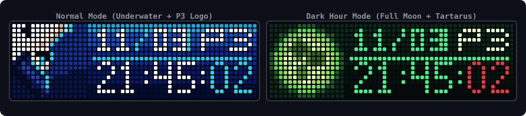

<div align="center">



# awtrix-p3r-clock

### Persona 3 Reload Clock for AWTRIX NG

[](https://github.com/Blueforcer/awtrix-ng)
[]()
[]()
[-green.svg)]()
[](LICENSE)

[English](README.md) | [繁體中文](README.zh-TW.md) | [日本語](README.ja.md) | [한국어](README.ko.md)

<p>『ペルソナ3 リロード』（Persona 3 Reload / P3R）の水中ビジュアルにインスパイアされた時計＆カレンダーアプリです。<br><strong>Ulanzi TC002</strong> および <strong>AWTRIX NG</strong> を搭載した 52×16 RGB LED マトリクスディスプレイ向けに設計されています。</p>

</div>

---

## ✨ 主な機能

- **単体・ネイティブ動作**：Berry スクリプト（`p3r.be`）を採用し、外部サーバーや追加の依存関係なしに ESP32 上でスタンドアロン動作。
- **通常モード（Normal Mode）**：
  - **左側 16×16 アイコン**：主人公・結城理の水中ドット絵アイコン。
  - **右側 36×16 パネル**：立ち上る気泡アニメーションをあしらったディープブルーの縦グラデーション背景。
  - **日付と曜日**：日付（`MM/DD`）と曜日（平日はイエロー、日曜日はレッド）。
  - **デジタル時計**：視認性の高い 4×7 デジタル時計表示（`HH:MM:SS`）。
- **影時間モード（Dark Hour / 00:00 〜 00:59）**：
  - 深夜 0 時になると自動的に「影時間」へ突入（設定から常時強制オンにすることも可能）。
  - **左側 16×16 アイコン**：不気味に輝く影時間の満月ドット絵アイコン。
  - **右側 36×16 パネル**：ダークグリーンのグラデーション背景。
  - **デジタル時計**：ネオングリーンに輝く時分表示と、妖しく刻まれるレッドの秒表示。
- **💥 召喚器（エヴォーカー）召喚カットイン（ボタン操作）**：
  - 本体のボタン（デフォルトは中央 **Select** ボタン）を押すと、名シーン「召喚器によるペルソナ召喚」カットインアニメーションが発動（銃の構え、目元のカットイン、発砲閃光、ガラス破片と青い炎の演出）。
  - **キャラクターボイス＆効果音**：結城理の召喚ボイスと銃声音を再生（内蔵ハードウェアシンセサイザーへの自動フォールバック搭載）。
- **P3 ロゴローテーション**：
  - 日付表示を常時キープしたまま、曜日スロットが 4 秒ごとに曜日と『P3』ロゴで交互に切り替わります。
- **Web UI 設定対応（`@config`）**：
  - AWTRIX NG の Web 管理画面から、タイムゾーンの変更、影時間モードの強制オン、P3 ロゴローテーションの切り替え、召喚ボタン割り当て、音声オン/オフが可能です。

---

## 📸 スクリーンショット

| モード | プレビュー |
|---|---|
| **💥 召喚器ペルソナ召喚アニメーション**<br>構え + 視線カットイン + 発砲閃光 + 砕け散るガラス片と青炎 PERSONA |  |
| **通常モード（曜日表示）**<br>結城理アイコン + 日付 / 曜日 + 時刻 |  |
| **通常モード（P3 ロゴ表示）**<br>結城理アイコン + 日付 / P3 ロゴ + 時刻 |  |
| **影時間モード（曜日表示）**<br>満月アイコン + 日付 / 曜日 + ネオングリーン時計 |  |
| **影時間モード（P3 ロゴ表示）**<br>満月アイコン + 日付 / P3 ロゴ + ネオングリーン時計 |  |

---

## 🛠️ 動作要件

- **ハードウェア**：Ulanzi TC002、または ESP32 / ESP32-S3 を搭載した 52×16 RGB LED マトリクスディスプレイ。
- **ファームウェア**：[AWTRIX NG](https://github.com/Blueforcer/awtrix-ng)。
- **画面解像度**：52×16 ピクセル（`# @display 52x16`）。

---

## 🚀 インストール方法

### 方法 1：AWTRIX Hub からインストール（推奨）
1. AWTRIX NG の Web UI を開き、**Hub** タブに移動します（または [AWTRIX Hub](https://blueforcer.github.io/awtrix-ng/) にアクセス）。
2. **Persona 3 Reload Clock** を検索します。
3. **Send to AWTRIX** をクリックすると、デバイスに直接インストールされます。

### 方法 2：手動インストール
1. ブラウザで AWTRIX NG の Web 管理画面（`http://<デバイスのIPアドレス>`）を開きます。
2. **Scripts** タブを開きます。
3. **Add Script** をクリックし、ファイル名に `p3r.be` と入力します。
4. [`app/p3r.be`](app/p3r.be) の全内容をコピーしてエディタに貼り付けます。
5. **Save** をクリックして保存します。これでアプロテーションに追加されます。

---

## 🔊 召喚ボイス・効果音の注意事項

本アプリは、ペルソナ召喚時に結城理のボイス（「ペルソナ！」）および銃声効果音の再生に対応しています。インストール方法によって音声の取り扱いが異なります：

### 1. AWTRIX Hub からインストール（推奨・自動音声付属）
- **AWTRIX Hub** から検索してインストールした場合、AWTRIX NG はスクリプト本体と専用の 8-bit `persona.mp3` 音声ファイルを自動的にバンドルダウンロードします（`/SCRIPTS/Persona3/persona.mp3` に保存）。
- **設定不要で即座に再生可能**：本体中央の Select ボタンを押すだけで、そのままボイス付きで再生されます。

### 2. 手動インストール（音声未登録時はハードウェアシンセサイザーで自動代用）
- 単一の `.be` スクリプトファイルにはバイナリ音声が含まれないため、手動で貼り付けて作成した場合はデバイス内に `persona.mp3` が存在しません。
- **自動フォールバック機能**：MP3 ファイルが未登録の場合、スクリプトは**自動的に TC002 内蔵のハードウェアシンセサイザー（Song Synthesizer）へ切り替わります**。ファイル不要で、チップから直接 8-bit 風の召喚銃声ノイズと「ペル・ソ・ナ！」メロディを合成出力します。
- **手動で 8-bit ボイスを登録する方法**：
  1. AWTRIX NG の Web 管理画面（`http://<デバイスIP>`）を開きます。
  2. **Audio** タブに移動するか、**Scripts** タブのエディタツールバーにある **🎵 音符アイコン**をクリックします。
  3. 本プロジェクトの [`assets/persona.mp3`](assets/persona.mp3) をアップロードすれば、本来の 8-bit ボイスが有効になります。

---

## ⚙️ 設定項目

AWTRIX NG 管理画面の **Apps** ページで、**Persona 3 Reload Clock** の横にある歯車アイコン（**⚙️**）をクリックして設定します：

| 設定項目 | タイプ | デフォルト値 | 説明 |
|---|---|---|---|
| `Timezone` (`timezone`) | `text` | `"Asia/Taipei"` | IANA タイムゾーン（例：`Asia/Tokyo`、`Asia/Taipei`、`UTC`）または数値オフセット（`+9`、`+8` など）。`"auto"` を指定するとデバイス本体のシステム時刻を使用します。 |
| `Force Dark Hour` (`force_dark`) | `bool` | `false` | 影時間テーマ（満月アイコン＆ダークグリーンのカラーパレット）を常時強制適用します。 |
| `Cycle P3 Logo` (`enable_p3_cycle`) | `bool` | `true` | 4 秒ごとに曜日スロットを曜日表示と P3 ロゴで交互に切り替えます。 |
| `Summon Button` (`trigger_btn`) | `text` | `"select"` | 召喚アニメーションを起動する本体ボタン：`select`（中央ボタン）、`middle`、`left`、`right`、または `any`。 |
| `Enable Sound` (`enable_sound`) | `bool` | `true` | 召喚時のボイス・効果音の再生を有効化します。 |

---

## 📂 プロジェクト構成

```text
awtrix-p3r-clock/
├── app/
│   └── p3r.be                   # AWTRIX NG 向け Berry アプリケーション
├── assets/
│   ├── persona.mp3              # 「ペルソナ！」召喚ボイス（AWTRIX Audio へアップロード）
│   ├── preview.svg              # プレビューバナー
│   ├── preview_summon.gif       # 召喚器ペルソナ召喚アニメーションプレビュー
│   ├── preview_normal_wed.png   # 通常モード（曜日表示）
│   ├── preview_normal_p3.png    # 通常モード（P3 ロゴ表示）
│   ├── preview_dark_wed.png     # 影時間モード（曜日表示）
│   └── preview_dark_p3.png      # 影時間モード（P3 ロゴ表示）
├── LICENSE                      # MIT ライセンス
├── README.md                    # 英語ドキュメント
├── README.zh-TW.md              # 繁体字中国語ドキュメント
├── README.ja.md                 # 日本語ドキュメント
└── README.ko.md                 # 韓国語ドキュメント
```

---

## 📄 ライセンスと免責事項

- 本プロジェクトのコードは [MIT License](LICENSE) のもとで公開されています。
- 『ペルソナ3 リロード』（*Persona 3 Reload*）および関連するすべてのキャラクター・資産の著作権は **株式会社アトラス / 株式会社セガ（ATLUS / SEGA）** に帰属します。本プロジェクトは非商用のファンメイド作品です。

