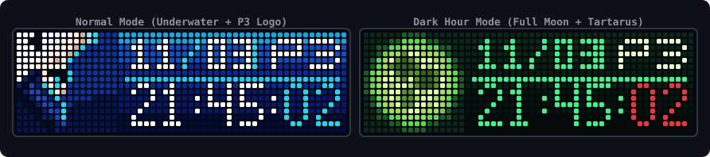

<div align="center">



# awtrix-p3r-clock

### Persona 3 Reload Clock for AWTRIX NG

[](https://github.com/Blueforcer/awtrix-ng)
[]()
[]()
[-green.svg)]()
[](LICENSE)

[English](README.md) | [繁體中文](README.zh-TW.md) | [日本語](README.ja.md) | [한국어](README.ko.md)

<p>《페르소나 3 리로드》(Persona 3 Reload, P3R)의 수중 비주얼 테마에서 영감을 받은 시계 및 캘린더 애플리케이션입니다.<br><strong>Ulanzi TC002</strong> 및 <strong>AWTRIX NG</strong> 펌웨어가 구동되는 52×16 RGB LED 매트릭스 디스플레이를 위해 제작되었습니다.</p>

</div>

---

## ✨ 주요 기능

- **단독 네이티브 구동 (Standalone)**: Berry 스크립트(`p3r.be`)로 작성되어 외부 서버나 추가 라이브러리 없이 ESP32 기기 자체에서 독립적으로 실행됩니다.
- **일반 모드 (Normal Mode)**:
  - **좌측 16×16 아이콘**: 주인공 유키 마코토의 수중 픽셀 아트 아이콘.
  - **우측 36×16 패널**: 떠오르는 물방울 애니메이션 효과가 적용된 오션 블루 수직 그라데이션 배경.
  - **날짜 및 요일**: 날짜(`MM/DD`)와 요일 표시 (월~토요일은 옐로우, 일요일은 레드).
  - **디지털 시계**: 가독성 높은 4×7 디지털 시계(`HH:MM:SS`).
- **섀도 타임 모드 (Dark Hour / 00:00 ~ 00:59)**:
  - 자정(00:00)이 되면 자동으로 섀도 타임으로 전환 (설정에서 상시 강제 활성화 가능).
  - **좌측 16×16 아이콘**: 섀도 타임 보름달(Full Moon) 픽셀 아트 아이콘.
  - **우측 36×16 패널**: 다크 그린 그라데이션 배경.
  - **디지털 시계**: 네온 그린 시/분과 붉은색 초 단위 표시.
- **P3 로고 순환 (Cycle P3 Logo)**:
  - 날짜 표시를 유지하면서 요일 슬롯이 4초마다 요일과 `P3` 로고로 교차 전환됩니다.
- **웹 UI 설정 지원 (`@config`)**:
  - AWTRIX NG 웹 관리 페이지에서 타임존 설정, 섀도 타임 강제 활성화, P3 로고 순환 여부를 손쉽게 제어할 수 있습니다.

---

## 📸 스크린샷

| 모드 | 미리보기 |
|---|---|
| **일반 모드 (요일 표시)**<br>유키 마코토 아이콘 + 날짜 / 요일 + 시계 |  |
| **일반 모드 (P3 로고 표시)**<br>유키 마코토 아이콘 + 날짜 / P3 로고 + 시계 |  |
| **섀도 타임 모드 (요일 표시)**<br>보름달 아이콘 + 날짜 / 요일 + 네온 시계 |  |
| **섀도 타임 모드 (P3 로고 표시)**<br>보름달 아이콘 + 날짜 / P3 로고 + 네온 시계 |  |

---

## 🛠️ 요구 사양

- **하드웨어**: Ulanzi TC002 또는 ESP32 / ESP32-S3 기반 52×16 RGB LED 매트릭스 디스플레이.
- **펌웨어**: [AWTRIX NG](https://github.com/Blueforcer/awtrix-ng).
- **디스플레이 해상도**: 52×16 픽셀 (`# @display 52x16`).

---

## 🚀 설치 방법

### 방법 1: AWTRIX Hub에서 설치 (권장)
1. AWTRIX NG 웹 관리 페이지를 열고 **Hub** 탭으로 이동합니다 (또는 [AWTRIX Hub](https://blueforcer.github.io/awtrix-ng/) 방문).
2. **Persona 3 Reload Clock**을 검색합니다.
3. **Send to AWTRIX**를 클릭하면 기기에 즉시 설치됩니다.

### 방법 2: 수동 설치
1. 브라우저에서 AWTRIX NG 웹 관리 페이지(`http://<기기-IP>`)에 접속합니다.
2. **Scripts** 탭으로 이동합니다.
3. **Add Script** 버튼을 클릭하고 파일명으로 `p3r.be`를 입력합니다.
4. [`app/p3r.be`](app/p3r.be)의 코드 전체를 복사하여 편집기에 붙여넣습니다.
5. **Save**를 클릭하여 저장하면 앱 목록에 등록됩니다.

---

## ⚙️ 설정 항목

AWTRIX NG 관리자 페이지의 **Apps** 메뉴에서 **Persona 3 Reload Clock** 옆의 톱니바퀴 아이콘(**⚙️**)을 클릭하여 설정합니다:

| 설정 항목 | 데이터 타입 | 기본값 | 설명 |
|---|---|---|---|
| `Timezone` (`timezone`) | `text` | `"Asia/Taipei"` | IANA 타임존 (예: `Asia/Seoul`, `Asia/Tokyo`, `UTC`) 또는 숫자 오프셋 (`+9`, `+8` 등). `"auto"`로 설정하면 기기 기본 시스템 시간을 사용합니다. |
| `Force Dark Hour` (`force_dark`) | `bool` | `false` | 섀도 타임 테마(보름달 아이콘 및 다크 그린 색상 구성)를 항상 강제로 켭니다. |
| `Cycle P3 Logo` (`enable_p3_cycle`) | `bool` | `true` | 4초마다 요일 표시 위치를 요일과 P3 로고로 번갈아 전환합니다. |

---

## 📂 프로젝트 구조

```text
awtrix-p3r-clock/
├── app/
│   └── p3r.be                 # AWTRIX NG용 Berry 애플리케이션
├── assets/
│   ├── preview.svg            # LED 미리보기 배너
│   ├── preview_normal_wed.png # 일반 모드 (요일 표시)
│   ├── preview_normal_p3.png  # 일반 모드 (P3 로고 표시)
│   ├── preview_dark_wed.png   # 섀도 타임 모드 (요일 표시)
│   └── preview_dark_p3.png    # 섀도 타임 모드 (P3 로고 표시)
├── LICENSE                    # MIT 라이선스
├── README.md                  # 영문 문서
├── README.zh-TW.md            # 번체 중국어 문서
├── README.ja.md               # 일본어 문서
└── README.ko.md               # 한국어 문서
```

---

## 📄 라이선스 및 면책 조항

- 본 프로젝트의 코드는 [MIT License](LICENSE)에 따라 배포됩니다.
- 《페르소나 3 리로드》(*Persona 3 Reload*) 및 관련 캐릭터와 디자인 에셋에 대한 모든 저작권은 **ATLUS / SEGA**에 있습니다. 본 프로젝트는 비상업적 팬 창작물입니다.

