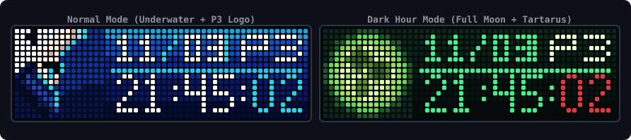

<div align="center">



# awtrix-p3r-clock

### Persona 3 Reload Clock for AWTRIX NG

[](https://github.com/Blueforcer/awtrix-ng)
[]()
[]()
[-green.svg)]()
[](LICENSE)

[English](README.md) | [繁體中文](README.zh-TW.md) | [日本語](README.ja.md) | [한국어](README.ko.md)

<p>A clock and calendar application inspired by <strong>Persona 3 Reload</strong> (P3R) underwater visuals, designed for <strong>Ulanzi TC002</strong> and 52×16 RGB LED matrix displays running <strong>AWTRIX NG</strong>.</p>

</div>

---

## ✨ Features

- **Standalone On-Device App**: Written in Berry script (`p3r.be`), running natively on the ESP32 without external servers or dependencies.
- **Normal Mode**:
  - **Left 16×16 Icon**: Makoto Yuki underwater pixel art icon.
  - **Right 36×16 Panel**: Ocean blue gradient background with rising bubbles animation.
  - **Date & Weekday**: Date (`MM/DD`) and weekday (yellow for weekdays, red for Sunday).
  - **Clock**: 4×7 digital clock (`HH:MM:SS`).
- **Dark Hour Mode (00:00 ~ 00:59)**:
  - Automatically activates at midnight, or can be forced via settings.
  - **Left 16×16 Icon**: Dark Hour Full Moon pixel art icon.
  - **Right 36×16 Panel**: Dark green gradient background.
  - **Clock**: Neon green hours/minutes with red seconds.
- **💥 Evoker Persona Summon Cutscene (Button Interaction)**:
  - Press the device button (default: middle **Select** button) to trigger the iconic Persona 3 summoning animation (featuring Evoker aiming, dynamic Eye Cut-in, muzzle flash, glass shatter, and rising blue PERSONA flames).
  - **Voice Line & Sound Effects**: Plays Makoto's summon shout and gunshot sound effects (with automatic hardware synthesizer fallback).
- **P3 Logo Rotation**:
  - Alternates the weekday slot with the `P3` logo every 4 seconds while keeping the date visible.
- **Web UI Configuration (`@config`)**:
  - Configure timezone, force Dark Hour mode, toggle logo cycling, customize summon button, and enable/disable sound via the AWTRIX NG web UI.

---

## 📸 Screenshots

| Mode | Preview |
|---|---|
| **💥 Evoker Persona Summon**<br>Aiming + Eye Cut-in + Muzzle Flash + Glass Shatter & Flames |  |
| **Normal Mode (Weekday)**<br>Makoto Yuki Icon + Date / Weekday + Time |  |
| **Normal Mode (P3 Logo)**<br>Makoto Yuki Icon + Date / P3 Logo + Time |  |
| **Dark Hour Mode (Weekday)**<br>Full Moon Icon + Date / Weekday + Neon Clock |  |
| **Dark Hour Mode (P3 Logo)**<br>Full Moon Icon + Date / P3 Logo + Neon Clock |  |

---

## 🛠️ Requirements

- **Hardware**: Ulanzi TC002 or any ESP32 / ESP32-S3 powered 52×16 RGB LED matrix.
- **Firmware**: [AWTRIX NG](https://github.com/Blueforcer/awtrix-ng).
- **Display Resolution**: 52×16 pixels (`# @display 52x16`).

---

## 🚀 Installation

### Option 1: AWTRIX Hub (Recommended)
1. Open your AWTRIX NG Web UI and navigate to the **Hub** tab (or visit [AWTRIX Hub](https://blueforcer.github.io/awtrix-ng/)).
2. Search for **Persona 3 Reload Clock**.
3. Click **Send to AWTRIX** to install directly to your device.

### Option 2: Manual Installation
1. Open your AWTRIX NG Web UI (`http://<your-device-ip>`).
2. Go to the **Scripts** tab.
3. Click **Add Script** and name the file `p3r.be`.
4. Copy the entire contents of [`app/p3r.be`](app/p3r.be) and paste into the editor.
5. Click **Save**. The app will be added to your app rotation.

---

## 🔊 Summon Voice & Sound Effects Notes

This app supports playing Makoto Yuki's iconic summon voice line ("Persona!") along with gunshot sound effects during the summon cutscene. Depending on how you install the app, sound is handled as follows:

### 1. Installing via AWTRIX Hub (Recommended, Audio Included)
- When installed from **AWTRIX Hub**, AWTRIX NG automatically bundles and downloads the script alongside its dedicated 8-bit `persona.mp3` audio file (stored under `/SCRIPTS/Persona3/persona.mp3`).
- **Ready out of the box**: Pressing the middle Select button will immediately play the voice line with zero extra configuration needed.

### 2. Manual Installation (Hardware Synthesizer Fallback)
- Since a standalone `.be` script file cannot package binary audio data, manual installation does not automatically include `persona.mp3`.
- **Automatic Fallback Mechanism**: If no MP3 is uploaded, the script **automatically falls back to the TC002's built-in hardware synthesizer (Song Synthesizer)**, dynamically generating an 8-bit Evoker gunshot noise and "Per-so-na!" melodic saw wave harmony—no sound files required!
- **Uploading the 8-bit Voice File Manually**:
  1. Open your AWTRIX NG Web UI (`http://<your-device-ip>`).
  2. Navigate to the **Audio** tab, or click the **🎵 musical note icon** in the **Scripts** editor bar.
  3. Upload [`assets/persona.mp3`](assets/persona.mp3) to enable the complete 8-bit voice line.

---

## ⚙️ Configuration

Click the gear icon (**⚙️**) next to **Persona 3 Reload Clock** in the AWTRIX NG **Apps** management page:

| Setting | Type | Default | Description |
|---|---|---|---|
| `Timezone` (`timezone`) | `text` | `"Asia/Taipei"` | IANA timezone (e.g. `Asia/Taipei`, `Asia/Tokyo`, `UTC`) or numeric offset (`+8`, `-5`). Set to `"auto"` to use device system time. |
| `Force Dark Hour` (`force_dark`) | `bool` | `false` | Force Dark Hour theme (full moon and dark green palette). |
| `Cycle P3 Logo` (`enable_p3_cycle`) | `bool` | `true` | Alternate weekday slot every 4 seconds with the P3 logo. |
| `Summon Button` (`trigger_btn`) | `text` | `"select"` | Hardware button to trigger summon: `select` (middle button), `middle`, `left`, `right`, or `any`. |
| `Enable Sound` (`enable_sound`) | `bool` | `true` | Enable or mute voice lines and sound effects during summon. |

---

## 📂 Project Structure

```text
awtrix-p3r-clock/
├── app/
│   └── p3r.be                   # Berry application for AWTRIX NG
├── assets/
│   ├── persona.mp3              # Iconic "Persona!" summon shout (upload to AWTRIX Audio)
│   ├── preview.svg              # LED preview banner
│   ├── preview_summon.gif       # Animated Evoker summon cutscene preview
│   ├── preview_normal_wed.png   # Normal mode with Weekday
│   ├── preview_normal_p3.png    # Normal mode with P3 Logo
│   ├── preview_dark_wed.png     # Dark Hour mode with Weekday
│   └── preview_dark_p3.png      # Dark Hour mode with P3 Logo
├── LICENSE                      # MIT License
├── README.md                    # English Documentation
├── README.zh-TW.md              # Traditional Chinese Documentation
├── README.ja.md                 # Japanese Documentation
└── README.ko.md                 # Korean Documentation
```

---

## 📄 License & Disclaimer

- Code released under the [MIT License](LICENSE).
- *Persona 3 Reload* and related characters/assets are property of **ATLUS / SEGA**. This is a non-commercial fan creation.
