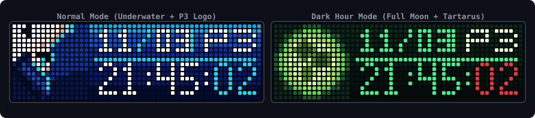

<div align="center">



# awtrix-p3r-clock

### Persona 3 Reload Clock for AWTRIX NG

[](https://github.com/Blueforcer/awtrix-ng)
[]()
[]()
[-green.svg)]()
[](LICENSE)

[English](README.md) | [繁體中文](README.zh-TW.md) | [日本語](README.ja.md) | [한국어](README.ko.md)

<p>以《女神異聞錄 3 Reload》（Persona 3 Reload, P3R）水下視覺風格為靈感設計的時鐘與日曆應用，專為 <strong>Ulanzi TC002</strong> 與 52×16 RGB LED 點陣螢幕（<strong>AWTRIX NG</strong> 韌體）打造。</p>

</div>

---

## ✨ 特色

- **獨立原生執行**：使用 Berry 腳本（`p3r.be`）於 ESP32 本地運行，無需外部伺服器或依賴。
- **正常模式**：
  - **左側 16×16 圖標**：結城理（主人公）水下點陣像素圖標。
  - **右側 36×16 區塊**：深藍垂直漸層背景，附帶上升氣泡動效。
  - **日期與星期**：顯示日期（`MM/DD`）與星期（週一至週六為黃色，週日為紅色）。
  - **時鐘**：4×7 數字時鐘（`HH:MM:SS`）。
- **影時間模式（Dark Hour - 00:00 ~ 00:59）**：
  - 午夜時段自動進入影時間，亦可於設定手動強制開啟。
  - **左側 16×16 圖標**：影時間綠色滿月圖標。
  - **右側 36×16 區塊**：暗綠漸層背景。
  - **時鐘**：霓虹綠時分搭配紅色秒數。
- **P3 標誌輪播**：
  - 每隔 4 秒於星期位置輪流切換星期與 `P3` 標誌（日期保持常駐）。
- **網頁端設定（`@config`）**：
  - 可在 AWTRIX NG 網頁後台設定時區、強制開啟影時間與切換標誌輪播。

---

## 📸 效果截圖

| 模式 | 預覽圖 |
|---|---|
| **正常模式（星期）**<br>結城理圖標 + 日期 / 星期 + 時間 |  |
| **正常模式（P3 標誌）**<br>結城理圖標 + 日期 / P3 標誌 + 時間 |  |
| **影時間模式（星期）**<br>滿月圖標 + 日期 / 星期 + 綠色時鐘與紅色秒數 |  |
| **影時間模式（P3 標誌）**<br>滿月圖標 + 日期 / P3 標誌 + 綠色時鐘與紅色秒數 |  |

---

## 🛠️ 硬體需求

- **硬體裝置**：Ulanzi TC002 或任何基於 ESP32 / ESP32-S3 的 52×16 RGB LED 點陣螢幕。
- **韌體版本**：[AWTRIX NG](https://github.com/Blueforcer/awtrix-ng)。
- **點陣規格**：52×16 像素（`# @display 52x16`）。

---

## 🚀 安裝方式

### 方法一：透過 AWTRIX Hub（推薦）
1. 開啟 AWTRIX NG 網頁後台，進入 **Hub** 標籤頁（或至 [AWTRIX Hub](https://blueforcer.github.io/awtrix-ng/)）。
2. 搜尋 **Persona 3 Reload Clock**。
3. 點擊 **Send to AWTRIX** 即可自動安裝至裝置。

### 方法二：手動安裝
1. 開啟 AWTRIX NG 網頁後台（`http://<裝置IP>`）。
2. 前往 **Scripts** 標籤頁。
3. 點選 **Add Script**，檔名輸入 `p3r.be`。
4. 複製 [`app/p3r.be`](app/p3r.be) 的完整程式碼並貼入編輯器。
5. 點擊 **Save** 儲存即可。

---

## ⚙️ 設定項目

在 AWTRIX NG 後台的 **Apps** 頁面中，點擊 **Persona 3 Reload Clock** 旁的齒輪圖示（**⚙️**）：

| 設定名稱 | 類型 | 預設值 | 說明 |
|---|---|---|---|
| `Timezone` (`timezone`) | `text` | `"Asia/Taipei"` | IANA 時區（如 `Asia/Taipei`, `Asia/Tokyo`, `UTC`）或數字時差（`+8`, `-5`）。設為 `"auto"` 則使用裝置系統時間。 |
| `Force Dark Hour` (`force_dark`) | `bool` | `false` | 強制開啟影時間主題（滿月與暗綠色調）。 |
| `Cycle P3 Logo` (`enable_p3_cycle`) | `bool` | `true` | 每 4 秒於星期位置輪播切換星期與 P3 標誌。 |

---

## 📂 專案結構

```text
awtrix-p3r-clock/
├── app/
│   └── p3r.be                 # AWTRIX NG Berry 應用程式
├── assets/
│   ├── preview.svg            # 預覽橫幅
│   ├── preview_normal_wed.png # 正常模式（星期）
│   ├── preview_normal_p3.png  # 正常模式（P3 標誌）
│   ├── preview_dark_wed.png   # 影時間模式（星期）
│   └── preview_dark_p3.png    # 影時間模式（P3 標誌）
├── LICENSE                    # MIT 授權條款
├── README.md                  # 英文說明文件
├── README.zh-TW.md            # 繁體中文說明文件
├── README.ja.md               # 日文說明文件
└── README.ko.md               # 韓文說明文件
```

---

## 📄 授權條款與版權聲明

- 本專案程式碼採用 [MIT License](LICENSE) 授權。
- 《女神異聞錄 3 Reload》（*Persona 3 Reload*）及其相關元素版權均屬 **ATLUS / SEGA** 所有。本專案為非營利愛好者創作。
